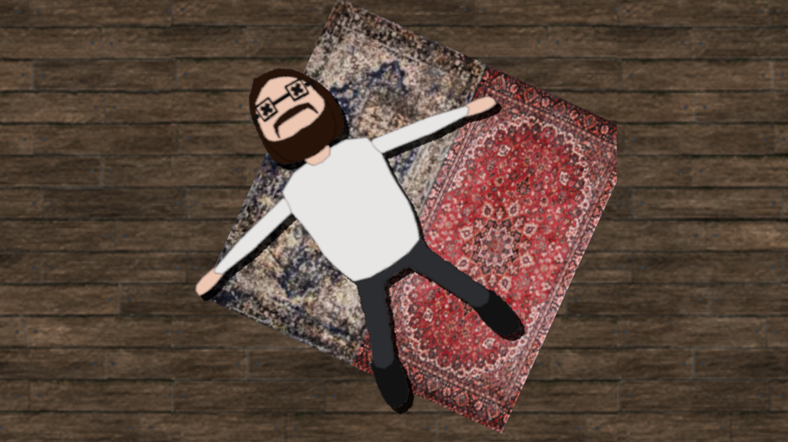

# IGJ-2024



> A short dark-comedy 3D narrative game made for the IGJ 2024 game jam. Edgar accidentally knocks out his flatmate Moisés with a door, and now has a few minutes to decide what to do about it before the neighbour comes knocking. *(In Portuguese.)*

**Content note:** the game is a black comedy about covering up an accident. It contains cartoonish violence, dark humour and strong language in the Portuguese dialogue.

## Table of contents

- [Overview](#overview)
- [Story and gameplay](#story-and-gameplay)
- [Controls](#controls)
- [Interactable objects](#interactable-objects)
- [Endings](#endings)
- [Requirements](#requirements)
- [Getting started](#getting-started)
- [Project structure](#project-structure)
- [How it works](#how-it-works)
- [Credits](#credits)
- [Known issues](#known-issues)
- [License](#license)

## Overview

IGJ-2024 is a choice-driven narrative game built in **Godot 4.2** with the **Dialogic 2** dialogue plugin. You play Edgar, walking around a low-poly, PlayStation-style apartment (third-person, fixed camera angles, tank-style movement) and interacting with household objects. Each object triggers a short, voice-acted dialogue with a decision, and the decisions you make decide how the story ends, which is told as a news report at the end.

The game features:

- A small 3D apartment with fixed camera rigs that switch as you move between rooms
- Fully branching dialogue written in Dialogic timelines, with voiced lines
- A countdown timer and knocking at the door that raises the pressure
- A long list of absurd ways to dispose of the evidence, each with its own ending
- A paint-sniffing hallucination shader, a credits scene and a custom main menu

## Story and gameplay

1. **Intro.** Edgar bursts through the front door and hits Moisés, who is standing behind it. Edgar can **call 112** (the sensible option, which ends the game on a happy note) or **try to hide the body**, which starts the actual game.
2. **First knock.** Someone knocks on the door. This is the neighbour, Tozé, who heard a loud crash. Edgar opens the door and chooses how to respond: admit it, gaslight him, lie, or say nothing. If Edgar hasn't washed his hands, Tozé notices the blood immediately.
3. **Exploring and hiding the evidence.** Between knocks you explore the apartment with a countdown running. Several objects can be combined to deal with the body, for example picking up the knife, chopping, then using bin bags or the fridge.
4. **Second knock.** Tozé returns, more suspicious, and storms in. If Edgar has found the watermelon, there is an extra, very silly option.
5. **Ending.** When the timer runs out, or you commit to a hiding place, the game cuts to a TV news report whose content depends on every choice you made.

The timer pauses while any dialogue is on screen. The door knocks at intervals as the time left shrinks, and in the second phase the door will not trigger the next event until enough time has passed.

## Controls

| Action | Key |
| --- | --- |
| Walk forward / backward | `W` / `S` |
| Turn left / right | `A` / `D` |
| Sprint | `Shift` |
| Interact with the nearest object | `E` |
| Advance dialogue | `Enter`, `Space` or `X` |

Movement is tank-style: `A` and `D` rotate Edgar, `W` and `S` move him along the direction he faces. Interaction picks the closest interactable inside Edgar's interaction area. Dialogue choices are selected with the mouse or keyboard focus.

## Interactable objects

Each object has its own Dialogic timeline in `timelines/objects/`.

| Object | What it does |
| --- | --- |
| Knife (`faca`) | Can be picked up. Required to chop up Moisés. |
| Moisés | Without the knife it is "too hard to move whole". With the knife you can chop him up, which also gets blood on your hands again. |
| Kitchen / bathroom sink (`lavatório`) | Wash your hands. Important when Tozé is at the door. |
| Bin bags (`sacos do lixo`) | Can be picked up for disposal. |
| Rubbish bin (`caixote do lixo`) | Throw Moisés away, but only chopped up and with bin bags in hand. |
| Rugs (`tapetes`) | Roll Moisés up in them, but only if he is still in one piece. |
| Fridge (`frigorífico`) | Store Moisés, but only if he has been chopped up. |
| Bed (`cama`) | Put Moisés to bed, but only if he is still in one piece. |
| Parcel service (`ctt`) | Ship the chopped remains to Rio de Janeiro. |
| Watermelon (`melancia`) | Pick it up. It can be thrown at Tozé in the second event. |
| Paint can (`sniff`) | Sniff it. This turns on a hallucination shader. |

## Endings

The ending is assembled in `timelines/endingTimeline.dtl` from the story variables, so there are many combinations. The main outcomes are:

- **Body in the bathtub:** the default if nothing else was done.
- **Body in the fridge, rolled in rugs, in bin bags, shipped to Rio, or in bed:** each with its own news report and its own suspect reasoning.
- **Chopped or intact:** changes how the body is described.
- **Tozé dead by watermelon:** adds a line about him being found with a melon on his head.
- **Time ran out, or hands unwashed:** Edgar is arrested.
- **Call 112 at the start:** a short, happy ending that skips the game entirely.

## Requirements

- [Godot](https://godotengine.org/download) **4.2 or newer** (project saved with 4.2, GL Compatibility renderer).
- A graphics card with OpenGL support.
- The bundled addons (no separate installation needed):
  - [Dialogic](https://github.com/dialogic-godot/dialogic) 2.0-Alpha-13
  - [VRM](https://github.com/V-Sekai/godot-vrm) importer 2.0.1
  - [Godot-MToon-Shader](https://github.com/V-Sekai/godot-mtoon-shader) 3.4.0
  - [Unidot importer](https://github.com/unidotgg/unidot-importer) 1.1.0
- [Blender](https://www.blender.org/) may be needed if Godot is to import the `.blend` source files in `Assets/` and `audio/` (the game imports them through Godot's Blender integration).

## Getting started

```bash
git clone https://github.com/UpForDebate/IGJ-2024.git
cd IGJ-2024
```

1. Open Godot and import `project.godot` from the Project Manager.
2. Wait for the first import to finish. There are many textures and models, so it can take a while.
3. If textures look missing or you see import errors for compressed textures, open **Project Settings > Rendering > Textures > VRAM Compression** and enable **Import S3TC BPTC**, then reimport. See [Known issues](#known-issues).
4. Press **F5** to run. The main scene is `scenes/main_menu.tscn`.

The repository is around 190 MB because of the apartment assets and the voice lines.

## Project structure

```
.
├── scenes/
│   ├── main_menu.tscn        Main menu (Play / Quit)
│   ├── player.tscn           Edgar: character, animations, interaction area
│   ├── zombie.tscn, zombieB.tscn, weapon.tscn, inventory_menu.tscn
│   │                         Prototype scenes carried over from early development
│   ├── camera/               Camera rig and camera-switch trigger zones
│   └── Blackscreen.tscn      Background used by the news-report ending
├── level.tscn                The apartment and the whole game loop
├── scripts/
│   ├── GameHandler.gd        Game state, timer, knocking, ending trigger
│   ├── Main Menu.gd          Play / Quit buttons
│   ├── player_controller.gd  Tank movement and interaction
│   ├── TimerOnScreen.gd      On-screen countdown label
│   ├── camera_rig.gd         Retro-style fixed camera that looks at the player
│   ├── camera_switch.gd      Switches active camera when the player enters a zone
│   └── zombie_controller.gd, weapon.gd, weapon_stats.gd   Prototype leftovers
├── timelines/
│   ├── introTimeline.dtl, firstEventTimeline.dtl,
│   │   secondEventTimeline.dtl, endingTimeline.dtl      The main story beats
│   ├── objects/              One timeline per interactable object
│   ├── voilines/             Recorded voice lines (WAV)
│   └── *.dch                 Dialogic characters: Edgar, Tozé, Pivot de TV
├── credits-scene/            Scrolling credits scene and credits text
├── materials/, shaders/      Materials, outline shader, textures
├── models/                   Character models (glTF/VRM-based)
├── Assets/                   PSX apartment and architecture packs, knife model
├── audio/                    Footsteps, knocking, sniff, credits song
└── addons/                   Dialogic, VRM, MToon shader, Unidot importer
```

## How it works

**Game loop.** `GameHandler.gd` lives on the root of `level.tscn`. It keeps a `state` counter and an array of timelines (intro, first event, second event, ending). `playTimeline()` starts the timeline for the current state, stops the timer, and restarts it when the dialogue finishes. Entering state 2 sets the timer to 180 seconds. When the timer runs out, or a timeline emits the `end` signal, the ending timeline is played.

**Dialogic and story variables.** Progress is stored in Dialogic variables defined in `project.godot`, for example `hasKnife`, `hasTrashBags`, `hasMelancia`, `isHandsWashed`, `isMoisesChopped`, `isMoisesFridged`, `isTozeDead` and `isTimerOver`. Timelines read and set them, and the ending timeline branches on them to build the news report.

**Signals from dialogue.** Timelines can fire Dialogic signals that `GameHandler.gd` reacts to: `end` (jump to the ending), `sniff` (show the hallucination shader), `toze` (make Tozé visible), `deleteInteractable` (remove the object the player just used) and `backToMenu` (load the credits).

**Interaction.** Interactable nodes carry two metadata entries: `interactTimeline` (the Dialogic timeline to start) and `door` (whether using it advances the story). The player script finds the closest overlapping body in its interaction area and starts that timeline when `E` is pressed. Movement and interaction are disabled while a timeline is running.

**Cameras.** `camera_rig.gd` keeps each fixed camera looking at the player (in the style of the "retro camera system" it credits), and `camera_switch.gd` activates a different camera when the player walks into a trigger area, which gives the survival-horror look.

## Credits

**Team**

- Producer: Diogo "Finix" Rocha
- Programmers: Edgar Amorim, Diogo "Finix" Rocha
- Graphic designers: Nyx, Joel Salvador
- Technical artist: Diogo Martins
- Main character: Edgar Amorim
- Water boy: Diogo Martins
- Melancia: Joelia
- Mascote: Inês
- Credits song ("surprise song idfk" / "flash song"): Edgar Amorim
- Special thanks: Moisés Moreira, Saldanha

**Third-party assets**

- PSX Knife by Wildenza
- PSX Assets Apartment Pack by rbarong
- PSX Architecture Pack by Comp-3 Interactive
- Retro camera approach inspired by Lukky's [retro camera system](https://github.com/lukky-nl/retro_camera_system)
- Addons: Dialogic, VRM, Godot-MToon-Shader and Unidot importer, each under its own license in `addons/`

## Known issues

- **Case-sensitive file systems.** Some materials reference `Assets/Architecture Pack/.../textures/...` while the folders on disk are named `Textures`, `Materials` and so on. This works on Windows and macOS (default) but fails on Linux, where textures and materials fail to load and `level.tscn` may not open. Renaming the folders or the references to a consistent case fixes it.
- **VRAM-compressed textures.** The texture `.import` files use VRAM compression. If the project setting that allows S3TC/BPTC import is disabled, Godot may skip those textures on a fresh clone.
- **Prototype leftovers.** The zombie, weapon and inventory scenes and scripts appear to be early prototype work and are not part of the story flow.
- **Stray files.** `scenes/sam67D8.tmp` looks like a temporary editor file, and `audio/` contains a duplicate copy of the apartment textures.
- **Alpha plugin.** The project uses a pre-release Dialogic 2 build, so updating the plugin may break timelines.
- Dialogue and voice lines are in **European Portuguese only**.
